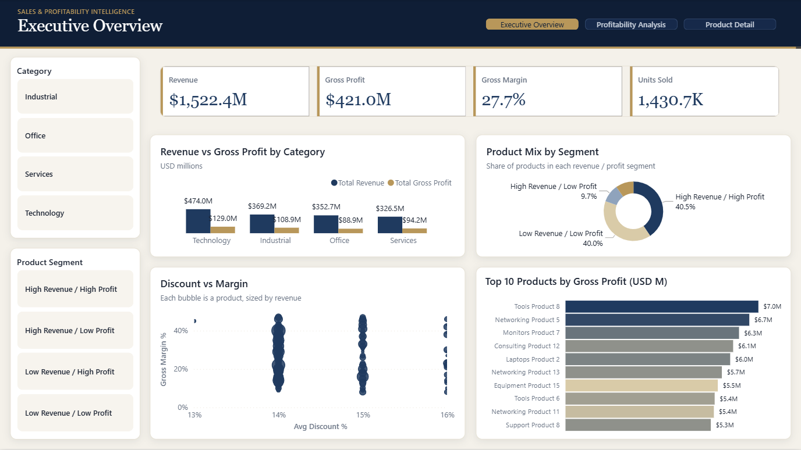
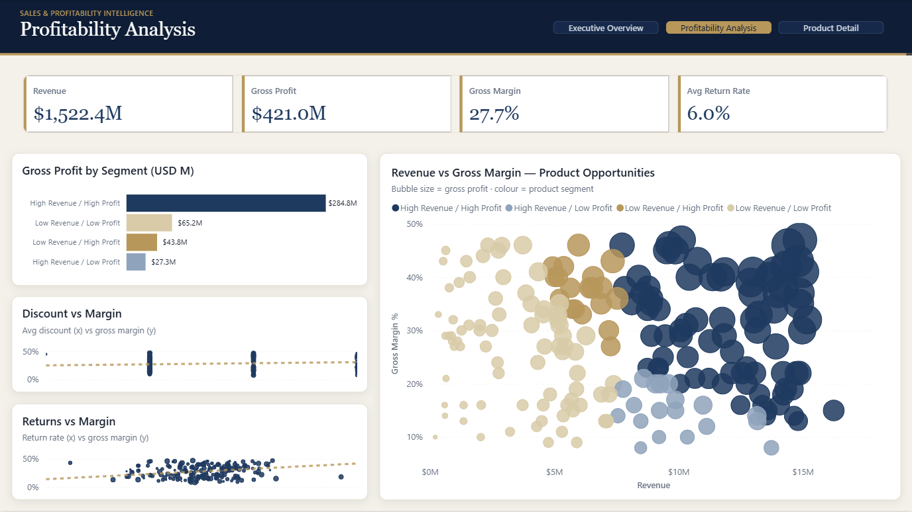
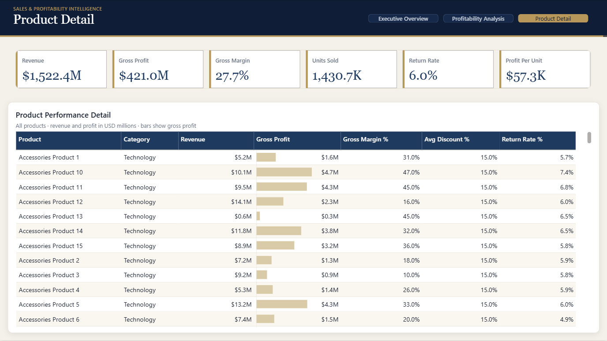

<div align="center">

# Sales & Profitability Intelligence

**Revenue is growing, but profit isn't keeping pace. This project finds out why.**

An end-to-end analytics project: **SQL** for data validation and root-cause analysis, **Python** for product segmentation, and a **Power BI** executive dashboard that turns about 90,000 orders into decisions management can act on.


</div>

---

## Dashboard Preview



<table>
  <tr>
    <td width="50%"></td>
    <td width="50%"></td>
  </tr>
  <tr>
    <td align="center"><b>Profitability Analysis</b>: where margin is won and lost</td>
    <td align="center"><b>Product Detail</b>: product-level performance table</td>
  </tr>
</table>

---

## The Business Problem

> *Revenue has been growing, but profitability isn't growing at the same pace.*

Management asked one question:

**"What is driving revenue and profitability, where are we losing margin, and what actions should we take?"**

To answer it, the analysis is broken into five questions:

1. How have revenue and margin moved over time, and in which months did revenue grow while margin fell?
2. Which regions, categories and products drive profit, and are the biggest sellers also the most profitable?
3. Which customers bring in high revenue but low or negative profit?
4. Do discounts erode margin, and at what discount levels?
5. How much value is lost to returns, and which products are affected most?

---

## Key Insights

| # | Finding | Evidence |
|---|---------|----------|
| 1 | **Profit is concentrated.** | The top 20% of products produce **43%** of gross profit. 79 "High Revenue / High Profit" products bring in **62%** of revenue and **68%** of profit. |
| 2 | **19 products are a margin leak.** | The **"High Revenue / Low Profit"** segment brings in **$187.8M (12%)** of revenue but only **6%** of profit, at a **14.5%** margin, about half the company average of **27.7%**. |
| 3 | **19 products are under-used.** | **"Low Revenue / High Profit"** products earn a **37.2%** margin, the highest of any segment, but make up only **8%** of revenue. |
| 4 | **Office is the weakest category.** | Margin is **25.2%**, compared with **29.5%** for Industrial. Technology is the largest category (**31%** of revenue) and has the highest average discount (**15.3%**). |
| 5 | **Returns are a material cost.** | **6.0%** of units sold are returned, worth **$81.1M**, about **5%** of revenue. |
| 6 | **The product-level margin gap comes from pricing and cost, not discounts.** | Average discounts fall in a narrow 13–16% band, and discount has almost no correlation with product margin (r ≈ −0.07). Low-margin products are expensive to supply rather than heavily discounted. |

### Recommendations

- **Re-price or re-source the 19 "High Revenue / Low Profit" products.** Raising their margin to the company average would add about **$25M** of gross profit at current volumes.
- **Grow the "Low Revenue / High Profit" segment** with targeted promotion and sales incentives, since every extra dollar of revenue there earns about 37¢ of gross profit.
- **Review the cost structure of Office products** and tighten discounting rules for Technology.
- **Run a returns-reduction programme** focused on the products with the highest return rates, to recover part of the $81M lost to returns.

---

## Approach

```
 Raw CSVs ──► SQL Server ──► Python ──► Power BI
 (7 tables)   validation &    segmentation  semantic model,
              root-cause      & ranking     DAX, dashboard
              queries
```

### 1. SQL: validation and root-cause analysis
[`SalesProfitabilityDB.sql`](SalesProfitabilityDB.sql) loads and validates the data: row counts, duplicate keys, and orders or order lines with no matching customer or product.

[`SQLQuery1.1.sql`](SQLQuery1.1.sql) holds the analytical queries, written with **CTEs, window functions (`LAG`, `RANK`, `NTILE`, `SUM() OVER ()`), and `NULLIF`-safe ratio calculations**. It covers:
- Monthly revenue and margin trends, month-over-month growth, and months where revenue rose but margin fell
- Regional profit contribution and product profitability rankings
- Customer segmentation, including a **"danger zone"** of customers in the top 20% by revenue and bottom 20% by margin
- Discount banding (0–5% … 20%+) against gross margin
- Return-rate analysis, and a combined **root-cause dataset** at product level

### 2. Python: feature engineering
The SQL product dataset is enriched with:
- **Profit per unit** and **profit rank**
- A **2×2 product segmentation** based on median revenue (~$7.6M) and median gross profit (~$1.9M), giving four segments: *High/High, High/Low, Low/High, Low/Low*

Output: [`Product_Profitability_Python_Enhanced.csv`](Sales_Profitability_Project/Product_Profitability_Python_Enhanced.csv)

### 3. Power BI: semantic model and dashboard
- A dedicated `Executive_Measures` table holds the DAX measures: *Total Revenue, Total Cost, Total Gross Profit, Gross Margin %, Total Units Sold, Average Return Rate %*
- Three pages, *Executive Overview*, *Profitability Analysis* and *Product Detail*, linked by a page navigator
- A custom **"Navy & Champagne"** report theme, with a fixed colour for each segment across all visuals
- Saved as a **Power BI Project (PBIP)**, so the model (TMDL) and report (JSON) are plain text that version control can track

---

## Dataset

A synthetic enterprise sales dataset, built with realistic business patterns and noise so that the answers have to be investigated rather than read off.

| Table | Rows | Description |
|-------|-----:|-------------|
| `Orders` | 90,000 | Order header: date, customer, sales rep, region, status |
| `Order_Lines`* | – | Line-level quantity, sales, discount, cost and gross profit |
| `Customers` | 8,000 | Segment, industry, region, customer-since date |
| `Products` | 195 | Category, subcategory, list price, unit cost |
| `Returns` | 19,099 | Returned quantity, reason and amount |
| `Sales_Reps` | 15 | Sales rep, region, hire date |
| `Date` | 1,096 | Calendar dimension (3 years) |

<sub>* `Order_Lines` lives in the SQL Server database and is used by the SQL queries.</sub>

---

## Repository Structure

```
├── Profitability_Analysis.pbix            # Power BI report (open directly in Power BI Desktop)
├── Profitability_Analysis.pbip            # Power BI Project entry point
├── Profitability_Analysis.Report/         # Report definition (pages, visuals, theme)
├── Profitability_Analysis.SemanticModel/  # Data model in TMDL (tables, DAX measures)
├── SalesProfitabilityDB.sql               # Data loading checks & validation
├── SQLQuery1.1.sql                        # Analytical / root-cause SQL queries
├── Sales_Profitability_Project/
│   └── Product_Profitability_Python_Enhanced.csv   # Python-enriched model input
├── Product_Profitability_Analysis.csv     # SQL output (product root-cause dataset)
├── Customers.csv · Orders.csv · Products.csv · Returns.csv · Sales_Reps.csv · Date.csv
├── images/                                # Dashboard screenshots
└── Business Problem.txt                   # Original problem statement
```

---

## How to Run

1. **Clone** the repository.
2. **Open the dashboard** in one of two ways:
   - Open `Profitability_Analysis.pbix` in Power BI Desktop, **or**
   - Open `Profitability_Analysis.pbip`. On the first open, go to *Transform data → Data source settings* and point the source to your local copy of `Sales_Profitability_Project/Product_Profitability_Python_Enhanced.csv`, then click **Refresh**.
3. **Reproduce the SQL analysis** (optional): load the CSVs into a SQL Server database, run `SalesProfitabilityDB.sql` to validate them, then run the queries in `SQLQuery1.1.sql`.

> Requires Power BI Desktop (2024 or later, with PBIP support) and SQL Server / SSMS.

---

## Skills Demonstrated

`Business problem framing` · `Data validation` · `T-SQL (CTEs, window functions)` · `Root-cause analysis` · `Customer & product segmentation` · `Feature engineering in Python` · `Data modelling` · `DAX` · `Dashboard UX & report theming` · `Version-controlled BI (PBIP / TMDL)` · `Executive storytelling`

---

## Author

**Hashir Adnan**: Data Analyst
[LinkedIn]((https://www.linkedin.com/in/hashiradnan/)) · [Email](hashir.adnan@gmail.com)

<sub>If you found this project useful, consider giving it a ⭐.</sub>
